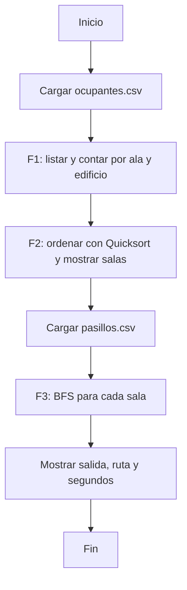
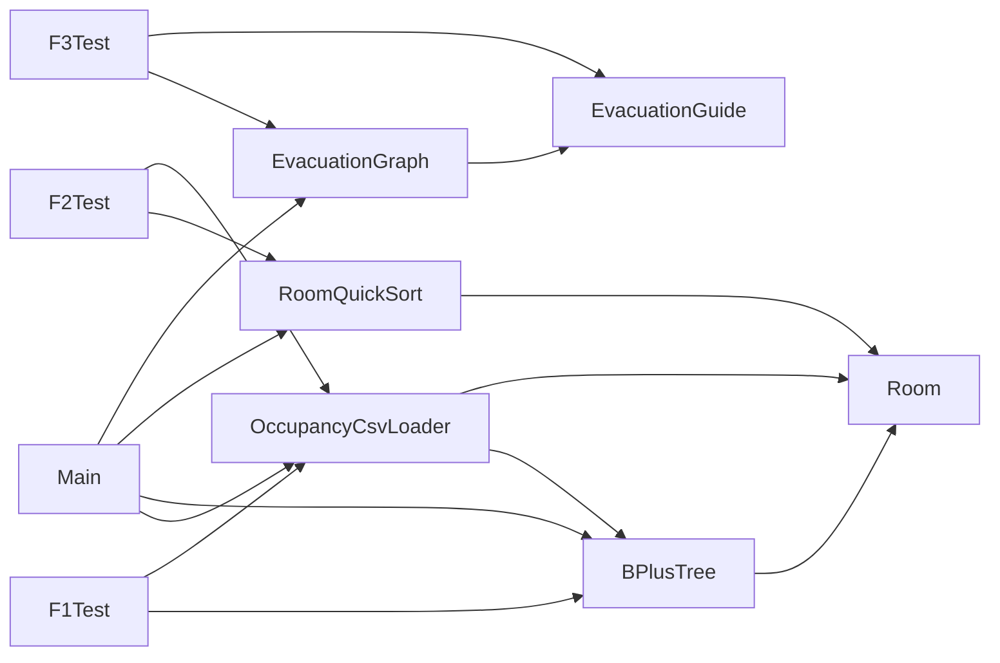
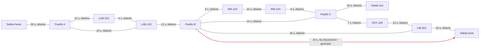

# Examen 2 – SalidaSegura

Algoritmos y Estructuras de Datos I, II Semestre 2026, Instituto Tecnológico de Costa Rica.

## Autores

- Carlos Dawan Zhou Fernández
- Sofía Vargas González

## Requerimientos del sistema

### REQUERIMIENTOS DEL FEATURE F1

F1. Estructura: Árbol B+. Complejidad: O(log n). Alternativa descartada: Árbol AVL. La razón fue para aprovechar en el B+ la característica del orden de rango, ya que AVL, cuando se ordena, no respeta el orden original. También era importante en el B+ que cada hoja está enlazada, permitiendo contar los ocupantes.
Requerimientos:
- Que la estructura sea capaz de respetar el orden de rango de sala -> ala -> edificio.
- Que el sistema sea capaz de listar su contenido, actualizarlo y enumerar sus ocupantes.

### REQUERIMIENTOS DEL FEATURE F2

F2. Algoritmo: Quicksort. Complejidad: n log n. Otra opción a tomar en cuenta es Bubblesort, por ejemplo; sin embargo, ya que el sistema requiere rapidez, se elige Quicksort, ya que es su cualidad más importante en este caso.
Requerimientos:
- Que sea capaz de enlistar 400 salas en orden de mayor a menor ocupante.
- Que sea un sistema eficiente, ya que debe hacer los cálculos en 1 segundo.

### REQUERIMIENTOS DEL FEATURE F3

F3. Para la guía de evacuación nos piden un grafo que guíe a los ocupantes por la salida y pasillos por los que puedan salir del edificio en el menor tiempo posible, tomando en cuenta que hay pasillos bloqueados y sus tres salidas. Para este caso usaríamos un grafo BFS con complejidad O(V+E). Este, al funcionar en colas y buscar el camino con menos aristas, sería la opción más eficaz para realizar una ruta de evacuación.


## Instrucciones de instalación y ejecución

### Requisitos

- JDK 17 o superior.
- Maven.

### Compilar

Desde la raíz del repositorio:

```shell
cd java
mvn compile
```

### Ejecutar el programa principal

Desde la carpeta `java/` (la ruta de los datos del programa es relativa a esta carpeta):

```shell
java -cp target/classes cr.ac.tec.examen2.Main
```

Salida del programa con los CSV incluidos:

```text
Personas por ala:
Oeste: 54
Este: 51
Central: 75
Personas en todo el edificio: 180
Salas de mayor a menor ocupantes:
LIB-001 - Biblioteca (Este): 45
RM-103 - Sala de clases (Central): 45
RM-104 - Sala de seminarios (Central): 30
LAB-102 - Laboratorio de física (Oeste): 30
LAB-101 - Laboratorio de química (Oeste): 24
OFF-105 - Oficina de docentes (Este): 6
Guías de evacuación:
LIB-001: LIB-001 -> Salida Este (25 segundos)
RM-103: RM-103 -> Pasillo B -> Pasillo C -> Salida Sur (40 segundos)
RM-104: RM-104 -> Pasillo C -> Salida Sur (27 segundos)
LAB-102: LAB-102 -> Pasillo A -> Salida Norte (35 segundos)
LAB-101: LAB-101 -> Pasillo A -> Salida Norte (30 segundos)
OFF-105: OFF-105 -> Pasillo C -> Salida Sur (25 segundos)
```

### Ejecutar las pruebas unitarias

Desde la raíz del repositorio:

```shell
cd java
mvn test
```

## Jerarquía de carpetas

```text
.
├── datos/
│   ├── version-a/
│   │   ├── abordajes.csv
│   │   └── tramos.csv
│   └── version-b/
│       ├── ocupantes.csv
│       └── pasillos.csv
├── java/
│   ├── pom.xml
│   └── src/
│       ├── main/java/cr/ac/tec/examen2/
│       │   ├── BPlusTree.java
│       │   ├── EvacuationGraph.java
│       │   ├── EvacuationGuide.java
│       │   ├── Main.java
│       │   ├── OccupancyCsvLoader.java
│       │   ├── Room.java
│       │   └── RoomQuickSort.java
│       └── test/java/cr/ac/tec/examen2/
│           ├── F1Test.java
│           ├── F2Test.java
│           ├── F3Test.java
│           └── SmokeTest.java
├── scripts/
│   └── verificar-restricciones.sh
├── .gitattributes
├── .gitignore
├── LICENSE
├── PROMPTS.md
└── README.md
```

### Clases de producción

- `Main`: carga el CSV de ocupantes, ejecuta F1, ordena y muestra las salas para F2 y genera las guías de evacuación para F3.
- `Room`: registro de código, nombre, ala y cantidad de ocupantes de una sala.
- `OccupancyCsvLoader`: valida y carga `ocupantes.csv` en el árbol B+.
- `BPlusTree`: árbol B+ de salas, con hojas enlazadas; permite insertar, listar, actualizar y contar ocupantes por ala y edificio.
- `RoomQuickSort`: implementación manual de Quicksort descendente por cantidad de ocupantes.
- `EvacuationGraph`: carga los pasillos y encuentra rutas con BFS y una cola implementada con arreglos.
- `EvacuationGuide`: registro de salida, secuencia de nodos de la ruta y suma de segundos.

### Pruebas

- `F1Test.java`: verifica carga y orden de las salas, conteos, actualización, casos límite y datos inválidos.
- `F2Test.java`: verifica orden descendente, empates, casos límite y entradas inválidas; incluye la prueba de 400 salas con límite de un segundo.
- `F3Test.java`: verifica rutas BFS, salidas, bloqueos, empates y datos inválidos.
- `SmokeTest.java`: comprueba el entorno de pruebas y que exista un CSV de datos.

## Requerimientos desarrollados por los estudiantes

### F1

Implementados: árbol B+ con hojas enlazadas; contenido ordenado por código de sala y ala; listado de registros de sala; actualización de ocupantes; conteo por ala y total del edificio.

Exclusiones y motivos: los CSV de ocupantes contienen cantidades por sala, no identidades de personas, por lo que se enumeran las salas y sus cantidades, no personas individuales. El CSV tampoco contiene un campo de edificio; el programa trata los registros como pertenecientes a un único edificio.

### F2

Implementados: Quicksort manual in-place por cantidad descendente; reporte ordenado de las salas cargadas; prueba de rendimiento con 400 salas y límite de un segundo. En empates no se agrega criterio de desempate.

Exclusiones y motivos: ninguna de las operaciones solicitadas para F2 se excluyó. El CSV incluido contiene seis salas; la prueba de 400 salas usa datos de prueba generados.

### F3

Implementados: grafo cargado desde `pasillos.csv`, exclusión de conexiones bloqueadas, BFS con cola propia basada en arreglos, selección de salida por menor número de aristas, secuencia de nodos y suma de segundos de la ruta.

Exclusiones y motivos: no se optimiza la ruta por menor suma de segundos. El BFS implementado sigue el criterio explícito de menor número de aristas; los segundos se suman y reportan para la ruta encontrada. Las conexiones abiertas del CSV se cargan en ambos sentidos.

## Diagramas en Mermaid

### Flujo del programa principal



### Componentes y dependencias



### Grafo de pasillos

Las conexiones abiertas se representan sin dirección porque el código las agrega en ambos sentidos. La línea roja discontinua marca la conexión bloqueada del CSV, que no se incorpora al grafo transitable.



## Prompts utilizados en la implementación

Los siguientes textos se incluyen completos y en orden, como están registrados en `PROMPTS.md`.

### Prompt 1

<pre>
Herramienta utilizada: Claude Code (extensión de VS Code).

Contexto: Estás trabajando en un repositorio base que ya tiene la estructura del proyecto y los datos en la carpeta datos/. Solo puedes usar como insumo (a) los requerimientos que te doy abajo y (b) los archivos CSV de la carpeta datos/. No uses ninguna otra fuente de información sobre el problema.

REGLAS OBLIGATORIAS
1. No sugieras mejoras, cambios, alternativas ni requerimientos nuevos. Implementa los requerimientos exactamente como están escritos, aunque te parezca que hay una mejor solución. No agregues funcionalidades que no se piden.
2. Si un requerimiento deja abierto un detalle de implementación, elige la opción más simple que lo cumpla literalmente, explícala en un comentario en el código y no la presentes como sugerencia.
3. Trabajaremos feature por feature. En este prompt implementa ÚNICAMENTE el Feature F1. No implementes nada de otros features ni dejes código adelantado para ellos.
4. Respeta la estructura de carpetas, paquetes y convenciones que ya existen en el repositorio base.

RESTRICCIONES DE IMPLEMENTACIÓN (obligatorias)
- Lenguaje: Java 17 o superior.
- Debes implementar tus propias estructuras de datos y algoritmos.
- Permitido: arreglos (por ejemplo int[] o Sala[]) y String.
- Prohibido: cualquier colección de java.util (ArrayList, LinkedList, HashMap, HashSet, TreeMap, TreeSet, PriorityQueue, Stack, ArrayDeque, entre otras), así como Arrays.sort, Collections.sort, List.sort y sorted() de Streams.
- Prohibido: bibliotecas que calculen caminos más cortos o que implementen grafos.
- Las pruebas unitarias pueden usar además JUnit (ya configurado en el repositorio).

REQUERIMIENTOS DEL FEATURE F1 (tal como fueron presentados; no los modifiques)
F1. Estructura: Árbol B+. Complejidad: O(log n). Alternativa descartada: Árbol AVL. La razón fue para aprovechar en el B+ la característica del orden de rango, ya que AVL, cuando se ordena, no respeta el orden original. También era importante en el B+ que cada hoja está enlazada, permitiendo contar los ocupantes.
Requerimientos:
- Que la estructura sea capaz de respetar el orden de rango de sala -> ala -> edificio.
- Que el sistema sea capaz de listar su contenido, actualizarlo y enumerar sus ocupantes.

METODOLOGÍA: TDD
Desarrolla con TDD: primero escribe las pruebas JUnit, verifica que fallen, luego implementa el código mínimo para que pasen y finalmente refactoriza. Por cada requerimiento funcional incluye como mínimo:
- Una prueba que compare el valor exacto esperado (assertEquals con el valor concreto calculado a partir de los CSV de datos/).
- Casos límite (por ejemplo: un ala vacía, empates, árbol con un solo elemento).
- Entradas inválidas (por ejemplo: una sala o ala inexistente, o un dato mal formado en el CSV), verificando el error o el resultado esperado.
Las pruebas no deben limitarse a verificar verdadero/falso.

EJECUCIÓN
Agrega al programa principal la ejecución de F1 cargando los datos desde datos/ y mostrando: personas por ala y en todo el edificio.

REGISTRO DE PROMPTS
Si no existe, crea el archivo PROMPTS.md en la raíz del repositorio. Agrega este prompt completo, textual y sin resumir, como "Prompt 1", indicando la herramienta utilizada (Claude Code, extensión de VS Code). Cada prompt que te envíe después también debe agregarse textualmente y en orden.

AL TERMINAR
Ejecuta todas las pruebas y muéstrame el resultado. Dame un resumen breve de los archivos creados o modificados y de qué requerimientos de F1 quedaron implementados. No propongas mejoras ni pasos adicionales. Espera mi siguiente prompt para el Feature F2.
</pre>

### Mensaje intermedio después del Prompt 1

<pre>
por favor no utilicez comimits sin mi permiso o avisarme
</pre>

### Prompt 2

<pre>
Herramienta utilizada: Claude Code (extensión de VS Code).

Continuamos con el mismo proyecto. Siguen aplicando todas las reglas y restricciones del Prompt 1. Las repito porque son obligatorias:

REGLAS OBLIGATORIAS
1. No sugieras mejoras, cambios, alternativas ni requerimientos nuevos. Implementa los requerimientos exactamente como están escritos, aunque te parezca que hay una mejor solución. No agregues funcionalidades que no se piden.
2. Si un requerimiento deja abierto un detalle de implementación, elige la opción más simple que lo cumpla literalmente, explícala en un comentario en el código y no la presentes como sugerencia.
3. En este prompt implementa ÚNICAMENTE el Feature F2. No modifiques el comportamiento de F1 salvo lo estrictamente necesario para reutilizar sus datos (por ejemplo, obtener la lista de salas ya cargadas). No implementes nada de F3.
4. Respeta la estructura de carpetas, paquetes y convenciones que ya existen en el repositorio.

RESTRICCIONES DE IMPLEMENTACIÓN (obligatorias)
- Lenguaje: Java 17 o superior.
- Debes implementar tus propias estructuras de datos y algoritmos.
- Permitido: arreglos (por ejemplo int[] o Sala[]) y String.
- Prohibido: cualquier colección de java.util (ArrayList, LinkedList, HashMap, HashSet, TreeMap, TreeSet, PriorityQueue, Stack, ArrayDeque, entre otras), así como Arrays.sort, Collections.sort, List.sort y sorted() de Streams.
- Prohibido: bibliotecas que calculen caminos más cortos o que implementen grafos.
- Las pruebas unitarias pueden usar además JUnit (ya configurado en el repositorio).

REQUERIMIENTOS DEL FEATURE F2 (tal como fueron presentados; no los modifiques)
F2. Algoritmo: Quicksort. Complejidad: n log n. Otra opción a tomar en cuenta es Bubblesort, por ejemplo; sin embargo, ya que el sistema requiere rapidez, se elige Quicksort, ya que es su cualidad más importante en este caso.
Requerimientos:
- Que sea capaz de enlistar 400 salas en orden de mayor a menor ocupante.
- Que sea un sistema eficiente, ya que debe hacer los cálculos en 1 segundo.

Implementa Quicksort a mano sobre un arreglo de salas, ordenando de mayor a menor cantidad de ocupantes. Como los requerimientos no definen un criterio de desempate, no agregues uno.

METODOLOGÍA: TDD
Desarrolla con TDD: primero escribe las pruebas JUnit, verifica que fallen, luego implementa el código mínimo para que pasen y finalmente refactoriza. Por cada requerimiento incluye como mínimo:
- Una prueba que compare el valor exacto esperado (assertEquals con el orden y los valores concretos calculados a partir de los CSV de datos/).
- Casos límite: arreglo vacío, una sola sala, salas con la misma cantidad de ocupantes (empates) y un arreglo ya ordenado. En los empates, como no hay criterio de desempate definido, verifica que la secuencia de ocupantes quede de mayor a menor y que no se pierda ni se duplique ninguna sala.
- Entradas inválidas: arreglo nulo, sala con ocupantes negativos o dato mal formado en el CSV, verificando el error o el resultado esperado.
- Para el requerimiento de eficiencia: una prueba que genere 400 salas y verifique, con assertTimeout de JUnit, que el ordenamiento termina en menos de 1 segundo y que el resultado queda en orden de mayor a menor.
Las pruebas no deben limitarse a verificar verdadero/falso.

EJECUCIÓN
Agrega al programa principal la ejecución de F2 con los datos de datos/, mostrando el reporte de salas de mayor a menor ocupantes.

REGISTRO DE PROMPTS
Agrega este prompt completo, textual y sin resumir, a PROMPTS.md como "Prompt 2", indicando la herramienta utilizada (Claude Code, extensión de VS Code). Verifica que el Prompt 1 y cualquier respuesta intermedia que te haya enviado ya estén registrados en orden.

AL TERMINAR
Ejecuta todas las pruebas (incluidas las de F1) y muéstrame el resultado. Dame un resumen breve de los archivos creados o modificados y de qué requerimientos de F2 quedaron implementados. No propongas mejoras ni pasos adicionales. Espera mi siguiente prompt para el Feature F3.
</pre>

### Mensaje intermedio después del Prompt 2

<pre>
no realices commits sin mi permiso, por favor.
</pre>

### Prompt 3

<pre>
Herramienta utilizada: Claude Code (extensión de VS Code).

Continuamos con el mismo proyecto. Siguen aplicando todas las reglas y restricciones de los prompts anteriores. Las repito porque son obligatorias:

REGLAS OBLIGATORIAS
1. No sugieras mejoras, cambios, alternativas ni requerimientos nuevos. Implementa los requerimientos exactamente como están escritos, aunque te parezca que hay una mejor solución o un algoritmo más adecuado. No reemplaces BFS por ningún otro algoritmo. No agregues funcionalidades que no se piden.
2. Si un requerimiento deja abierto un detalle de implementación, elige la opción más simple que lo cumpla literalmente, explícala en un comentario en el código y no la presentes como sugerencia.
3. En este prompt implementa ÚNICAMENTE el Feature F3. No modifiques el comportamiento de F1 ni de F2 salvo lo estrictamente necesario para reutilizar sus datos.
4. Respeta la estructura de carpetas, paquetes y convenciones que ya existen en el repositorio.

RESTRICCIONES DE IMPLEMENTACIÓN (obligatorias)
- Lenguaje: Java 17 o superior.
- Debes implementar tus propias estructuras de datos y algoritmos (el grafo y la cola del BFS deben ser propios, construidos con arreglos).
- Permitido: arreglos (por ejemplo int[] o Sala[]) y String.
- Prohibido: cualquier colección de java.util (ArrayList, LinkedList, HashMap, HashSet, TreeMap, TreeSet, PriorityQueue, Stack, ArrayDeque, entre otras), así como Arrays.sort, Collections.sort, List.sort y sorted() de Streams.
- Prohibido: bibliotecas que calculen caminos más cortos o que implementen grafos.
- Las pruebas unitarias pueden usar además JUnit (ya configurado en el repositorio).

REQUERIMIENTOS DEL FEATURE F3 (tal como fueron presentados; no los modifiques)
F3. Para la guía de evacuación nos piden un grafo que guíe a los ocupantes por la salida y pasillos por los que puedan salir del edificio en el menor tiempo posible, tomando en cuenta que hay pasillos bloqueados y sus tres salidas. Para este caso usaríamos un grafo BFS con complejidad O(V+E). Este, al funcionar en colas y buscar el camino con menos aristas, sería la opción más eficaz para realizar una ruta de evacuación.

Implementación esperada según los requerimientos:
- Construye el grafo con los datos de los CSV de datos/.
- Los pasillos bloqueados no se agregan al grafo (o se ignoran al recorrerlo).
- Para cada sala, usa BFS con una cola propia para encontrar el camino con menos aristas hacia cualquiera de las tres salidas.
- La guía de cada sala indica la salida a usar, la secuencia de pasillos a seguir y la suma de los segundos de los pasillos de esa ruta.

METODOLOGÍA: TDD
Desarrolla con TDD: primero escribe las pruebas JUnit, verifica que fallen, luego implementa el código mínimo para que pasen y finalmente refactoriza. Las pruebas deben verificar el comportamiento de BFS tal como está descrito (camino con menos aristas), calculando los valores esperados a partir de los CSV de datos/. Incluye como mínimo:
- Pruebas que comparen valores exactos esperados (assertEquals con la salida, la ruta y los segundos concretos de al menos una sala).
- Casos límite: una sala conectada directamente a una salida, origen igual a una salida, una sala sin ninguna ruta disponible porque todos sus caminos están bloqueados, y empates en cantidad de aristas.
- Entradas inválidas: sala inexistente, dato mal formado en el CSV (por ejemplo, segundos no numéricos o estado desconocido), verificando el error o el resultado esperado.
- Una prueba que verifique que ninguna ruta pasa por un pasillo bloqueado.
Las pruebas no deben limitarse a verificar verdadero/falso.

EJECUCIÓN
Agrega al programa principal la ejecución de F3 con los datos de datos/, mostrando la guía de evacuación para todas las salas.

REGISTRO DE PROMPTS
Agrega este prompt completo, textual y sin resumir, a PROMPTS.md como "Prompt 3", indicando la herramienta utilizada (Claude Code, extensión de VS Code). Verifica que todos los prompts anteriores y las respuestas intermedias que te haya enviado estén registrados en orden.

AL TERMINAR
Ejecuta todas las pruebas (F1, F2 y F3) y muéstrame el resultado. Dame un resumen breve de los archivos creados o modificados y de qué requerimientos de F3 quedaron implementados. No propongas mejoras ni pasos adicionales. Espera mi siguiente prompt para el README.
</pre>

### Prompt 4

<pre>
Herramienta utilizada: Claude Code (extensión de VS Code).

Continuamos con el mismo proyecto. Siguen aplicando todas las reglas y restricciones de los prompts anteriores: no sugieras mejoras, cambios ni requerimientos nuevos; no modifiques el código ni las pruebas de F1, F2 y F3; no realices commits sin mi permiso.

TAREA: reemplaza por completo el README.md de la raíz del repositorio (actualmente es el del repositorio base) por el README de nuestra solución, con estas secciones en este orden:

1. Nombre del examen-proyecto: "Examen 2 – SalidaSegura" (Algoritmos y Estructuras de Datos I, II Semestre 2026, Instituto Tecnológico de Costa Rica).
2. Autores: Carlos Dawan Zhou Fernández y Sofía Vargas González.
3. Requerimientos del sistema: copia textualmente, sin modificar ni una palabra, los bloques "REQUERIMIENTOS DEL FEATURE F1", "REQUERIMIENTOS DEL FEATURE F2" y "REQUERIMIENTOS DEL FEATURE F3" tal como aparecen en PROMPTS.md. No los resumas, no los reordenes, no los numeres de otra forma y no agregues requerimientos.
4. Instrucciones de instalación y ejecución: requisitos (JDK 17 o superior y Maven), cómo compilar, cómo ejecutar el programa principal y cómo ejecutar las pruebas unitarias, usando los comandos reales del proyecto. Incluye la salida real del programa principal al ejecutarlo.
5. Jerarquía de carpetas: árbol de carpetas del proyecto y una descripción breve de lo que hace cada clase de java/src/main y cada archivo de pruebas de java/src/test.
6. Requerimientos desarrollados por los estudiantes: indica, para F1, F2 y F3, qué requerimientos se implementaron y cuáles se excluyeron, con el motivo de cada exclusión. Básate solo en el código existente; no agregues ni cambies código.
7. Diagramas en Mermaid (bloques ```mermaid dentro del README):
   - Diagrama de flujo del programa principal (carga de datos, F1, F2, F3).
   - Diagrama de componentes con las clases del proyecto y sus dependencias.
   - Diagrama del grafo que emplea el sistema, construido a partir de datos/version-b/pasillos.csv, con los segundos de cada pasillo y marcando visualmente los pasillos bloqueados.
Verifica que la sintaxis Mermaid sea válida.
8. Prompts utilizados en la implementación: incluye todos los prompts registrados en PROMPTS.md, textuales, completos y en orden (Prompt 1, mensaje intermedio, Prompt 2, mensaje intermedio, Prompt 3 y este Prompt 4), indicando la herramienta utilizada.

TAMBIÉN:

- En PROMPTS.md, completa el encabezado: "Integrantes: Carlos Dawan Zhou Fernández, Sofía Vargas González" y "Herramienta(s) de IA utilizada(s): Claude Code (extensión de VS Code)".
- En PROMPTS.md, el mensaje "no realices commits sin mi permiso, por favor." quedó pegado al final del Prompt 2; sepáralo bajo su propio encabezado "## Mensaje intermedio después del Prompt 2", sin cambiar su texto.
- Elimina la carpeta csharp/, ya que la solución se hizo en Java, tal como indica el README del repositorio base.

REGISTRO DE PROMPTS
Agrega este prompt completo, textual y sin resumir, a PROMPTS.md como "Prompt 4", indicando la herramienta utilizada (Claude Code, extensión de VS Code).

AL TERMINAR
Ejecuta todas las pruebas para confirmar que nada se rompió y muéstrame el resultado. Dame un resumen breve de los archivos modificados. No propongas mejoras ni pasos adicionales.
</pre>

### Prompt 5

<pre>
Herramienta utilizada: Claude Code (extensión de VS Code).

Continuamos con el mismo proyecto. Siguen aplicando todas las reglas de los prompts anteriores: no sugieras mejoras ni cambios, no modifiques el código ni las pruebas, no realices commits sin mi permiso. Solo vas a editar README.md y PROMPTS.md.

TAREA 1: Registrar el uso de Claude (chat) en PROMPTS.md
Al final de PROMPTS.md, después de este Prompt 5, agrega una sección con el siguiente texto exactamente como está (cada mensaje dentro de un bloque &lt;pre&gt; como los demás prompts, sin cambiar ni una palabra ni la ortografía):

## Uso de Claude (chat en claude.ai) para redactar los prompts

Herramienta utilizada: Claude (chat en claude.ai, modelo Claude Opus 5.5). Se usó para revisar nuestras respuestas después del examen y para redactar los prompts 1 a 5 enviados a Claude Code. Claude no escribió el código de la solución. Aclaraciones: en el mensaje 1 se adjuntó el PDF del examen y se pidieron las respuestas de la Parte 1; Claude se negó a darlas porque esa parte no permitía el uso de IA. Los mensajes 2 y 3 se enviaron después de haber entregado la Parte 1 en papel, para revisar las respuestas ya entregadas; en el mensaje 3 se consultó si BFS podía usarse para F3, y a partir de esa conversación no se modificó ningún requerimiento. Mensajes enviados, en orden y textuales (hora de Costa Rica, 20 de noviembre de 2026):

Mensaje 1 (19:29), con el PDF del examen adjunto:
dime las respuestas de la parte b, solo citame los algoritmos que se deben usar

Mensaje 2 (19:30):
si esque acabo de llegar del examen, yo puse mis respuestas, use un arbol b+, quicksort y un BFS, estan bien?

Mensaje 3 (19:38):
bfs no es la solucion mas optima, pero igual se puede implementar bfs como una solucion para esto?

Mensaje 4 (20:37):
ahora para la parte de implementacion de codigo y resultado, necesito que hagas un prompt para poder copiarlo y pegarlo en la extension de claude de vs code. Este prompt lo voy a pegar en un repositorio que ya tiene la maqueta de los datos y formato que debe de seguir. ademas vamos feature por feature. debe de seguir estrictamente las implementaciones que se hicieron a partir de la respuesta que yo di, no puede implementar cosas nuevas. ademas sigue las recomendaciones y restricciones que aparecen en el pdf sobre el uso de la IA. la respuesta del F1 para la version B fue la siguiente: "Arbol B+, Complejidad: O (log n), se descarto Arbol AVL. La razon fue para aprovechar en el B+. La caracteristica del orden de rango, ya que AVL, cuando se ordena, no respeta el orden original. tambien, era importante en el B+ que cada hoja esta enlazada, permitiendo contar los ocupantes. Los requerimientos es que esta sea capaz de respetar el orden de rango de sala-&gt;ala-&gt;edificio. Otro requerimiento es que el sistema sea capaz de listar su contenido, actualizarlo y enumerar sus ocupantes".

Mensaje 5 (21:22):
haz lo mismo con el F2, "Quicksort, complejidad: n log n, otra opcion a tomar en cuenta es bubblesort por ejemplo, sin embargo, ya que el sistema requiere rapidez, se elige Quicksort ya que es su cualidad mas importante en este caso. Un requerimiento es que sea capaz de enlistar 400 salas en orden de mayor a menor ocupante. Otro requerimiento es que sea un sistema eficiente, ya que debe hacer los calculos en 1 segundo"

Mensaje 6 (21:27):
haz lo con F3: "Para la guia de evacuacion nos piden un grafo que guie a los ocupantes por la salida y pasillos por los que puedan salir del edificio en el menor tiempo posible, tomando en cuenta que hay pasillos bloqueados y sus tres salidas. Para este caso usariamos un grafo BFS con complejidad O(V+E). este al funcionar en colas y buscar el camino con menos aristas, seria la opcion mas eficaz para realizar una ruta de evacuacion"

Mensaje 7 (21:56):
https://github.com/CarlosZhou09/Examen-2-repositorio este es el repositorio para la entrega del examen, dime que hace falta y dame un prompt para pedirle que en el readme coloque los prompts usados para la implementacion y nuestros nombres que son Carlos Dawan Zhou Fernandez y Sofia Vargas Gonzalez

Mensaje 8 (22:31):
ahora si esta actualizado, verifica todo y dime si esta listo para entregar al profesor

Mensaje 9 (22:53): salida de error de Maven al ejecutar "mvn test" desde la raíz del repositorio ("there is no POM in this directory").

Mensaje 10 (22:56):
dame un prompt para agregar los prompts usados para realizar los prompts y dame un prompt para darselo a claude code extension

En el encabezado de PROMPTS.md, cambia la línea de herramientas a: "Herramienta(s) de IA utilizada(s): Claude Code (extensión de VS Code); Claude (chat en claude.ai) para redactar los prompts".

TAREA 2: Corregir la numeración del Prompt 4
En PROMPTS.md y en la sección de prompts del README, el Prompt 4 quedó con la numeración alterada. Corrige solo estas tres líneas para que queden como se enviaron originalmente:
- "1. Herramienta utilizada: Claude Code (extensión de VS Code)." debe quedar "Herramienta utilizada: Claude Code (extensión de VS Code)." (sin número).
- "2. 1. Diagramas en Mermaid (bloques ```mermaid dentro del README):" debe quedar "7. Diagramas en Mermaid (bloques ```mermaid dentro del README):".
- "2. Prompts utilizados en la implementación: ..." debe quedar "8. Prompts utilizados en la implementación: ..." (el resto de la línea igual).
Las tres viñetas de los diagramas van con sangría de tres espacios bajo el punto 7. Si el formato Markdown vuelve a renumerar las listas, deja el texto del prompt dentro de un bloque &lt;pre&gt; para que se conserve tal cual.

TAREA 3: Corregir la sección "Requerimientos del sistema" del README
- Debajo del requerimiento de F3, elimina completo el bloque "Implementación esperada según los requerimientos:" y sus cuatro viñetas. No era parte de los requerimientos presentados; era una instrucción del Prompt 3. No lo elimines de la sección de prompts ni de PROMPTS.md.
- En los tres títulos de esa sección, quita el texto "(tal como fueron presentados; no los modifiques)". Los títulos deben quedar "REQUERIMIENTOS DEL FEATURE F1", "REQUERIMIENTOS DEL FEATURE F2" y "REQUERIMIENTOS DEL FEATURE F3".
- No cambies ninguna otra palabra de los requerimientos.

TAREA 4: Sincronizar el README
En la sección "Prompts utilizados en la implementación" del README, agrega este Prompt 5 y la sección "Uso de Claude (chat en claude.ai) para redactar los prompts", igual que en PROMPTS.md.

REGISTRO DE PROMPTS
Agrega este prompt completo, textual y sin resumir, a PROMPTS.md como "Prompt 5", indicando la herramienta utilizada (Claude Code, extensión de VS Code), antes de la sección de Claude (chat).

AL TERMINAR
Ejecuta las pruebas desde la carpeta java/ con "mvn test" para confirmar que nada se rompió y muéstrame el resultado. Dame un resumen breve de los cambios. No propongas mejoras ni pasos adicionales.
</pre>

### Uso de Claude (chat en claude.ai) para redactar los prompts

Herramienta utilizada: Claude (chat en claude.ai, modelo Claude Opus 5.5). Se usó para revisar nuestras respuestas después del examen y para redactar los prompts 1 a 5 enviados a Claude Code. Claude no escribió el código de la solución. Aclaraciones: en el mensaje 1 se adjuntó el PDF del examen y se pidieron las respuestas de la Parte 1; Claude se negó a darlas porque esa parte no permitía el uso de IA. Los mensajes 2 y 3 se enviaron después de haber entregado la Parte 1 en papel, para revisar las respuestas ya entregadas; en el mensaje 3 se consultó si BFS podía usarse para F3, y a partir de esa conversación no se modificó ningún requerimiento. Mensajes enviados, en orden y textuales (hora de Costa Rica, 20 de noviembre de 2026):

Mensaje 1 (19:29), con el PDF del examen adjunto:

<pre>
dime las respuestas de la parte b, solo citame los algoritmos que se deben usar
</pre>

Mensaje 2 (19:30):

<pre>
si esque acabo de llegar del examen, yo puse mis respuestas, use un arbol b+, quicksort y un BFS, estan bien?
</pre>

Mensaje 3 (19:38):

<pre>
bfs no es la solucion mas optima, pero igual se puede implementar bfs como una solucion para esto?
</pre>

Mensaje 4 (20:37):

<pre>
ahora para la parte de implementacion de codigo y resultado, necesito que hagas un prompt para poder copiarlo y pegarlo en la extension de claude de vs code. Este prompt lo voy a pegar en un repositorio que ya tiene la maqueta de los datos y formato que debe de seguir. ademas vamos feature por feature. debe de seguir estrictamente las implementaciones que se hicieron a partir de la respuesta que yo di, no puede implementar cosas nuevas. ademas sigue las recomendaciones y restricciones que aparecen en el pdf sobre el uso de la IA. la respuesta del F1 para la version B fue la siguiente: "Arbol B+, Complejidad: O (log n), se descarto Arbol AVL. La razon fue para aprovechar en el B+. La caracteristica del orden de rango, ya que AVL, cuando se ordena, no respeta el orden original. tambien, era importante en el B+ que cada hoja esta enlazada, permitiendo contar los ocupantes. Los requerimientos es que esta sea capaz de respetar el orden de rango de sala-&gt;ala-&gt;edificio. Otro requerimiento es que el sistema sea capaz de listar su contenido, actualizarlo y enumerar sus ocupantes".
</pre>

Mensaje 5 (21:22):

<pre>
haz lo mismo con el F2, "Quicksort, complejidad: n log n, otra opcion a tomar en cuenta es bubblesort por ejemplo, sin embargo, ya que el sistema requiere rapidez, se elige Quicksort ya que es su cualidad mas importante en este caso. Un requerimiento es que sea capaz de enlistar 400 salas en orden de mayor a menor ocupante. Otro requerimiento es que sea un sistema eficiente, ya que debe hacer los calculos en 1 segundo"
</pre>

Mensaje 6 (21:27):

<pre>
haz lo con F3: "Para la guia de evacuacion nos piden un grafo que guie a los ocupantes por la salida y pasillos por los que puedan salir del edificio en el menor tiempo posible, tomando en cuenta que hay pasillos bloqueados y sus tres salidas. Para este caso usariamos un grafo BFS con complejidad O(V+E). este al funcionar en colas y buscar el camino con menos aristas, seria la opcion mas eficaz para realizar una ruta de evacuacion"
</pre>

Mensaje 7 (21:56):

<pre>
https://github.com/CarlosZhou09/Examen-2-repositorio este es el repositorio para la entrega del examen, dime que hace falta y dame un prompt para pedirle que en el readme coloque los prompts usados para la implementacion y nuestros nombres que son Carlos Dawan Zhou Fernandez y Sofia Vargas Gonzalez
</pre>

Mensaje 8 (22:31):

<pre>
ahora si esta actualizado, verifica todo y dime si esta listo para entregar al profesor
</pre>

Mensaje 9 (22:53):

<pre>
salida de error de Maven al ejecutar "mvn test" desde la raíz del repositorio ("there is no POM in this directory").
</pre>

Mensaje 10 (22:56):

<pre>
dame un prompt para agregar los prompts usados para realizar los prompts y dame un prompt para darselo a claude code extension
</pre>
